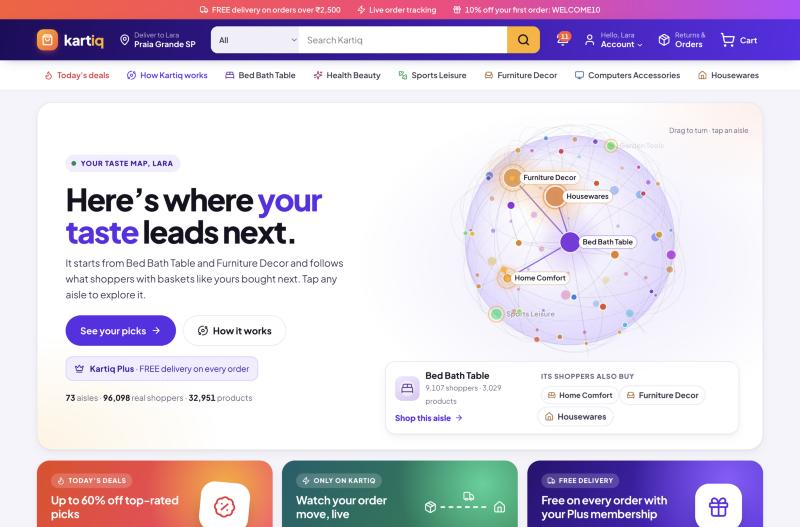
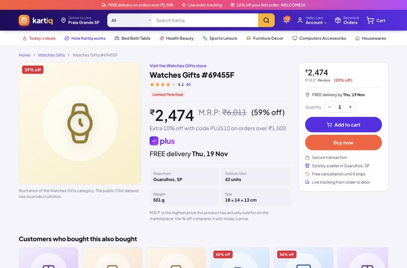
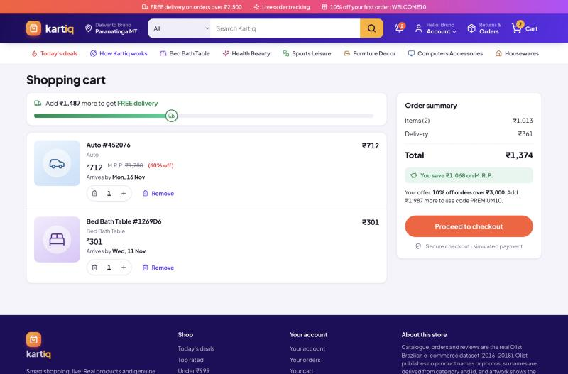
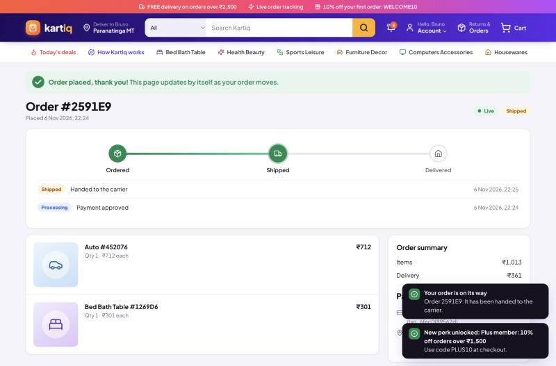
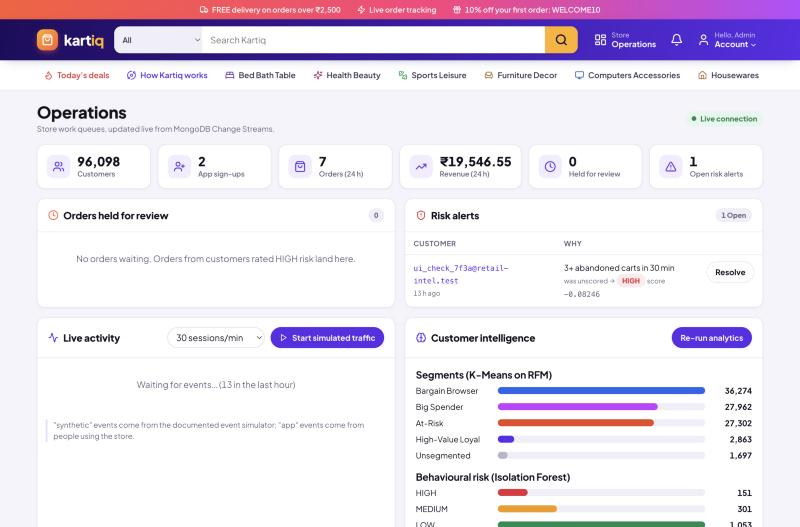
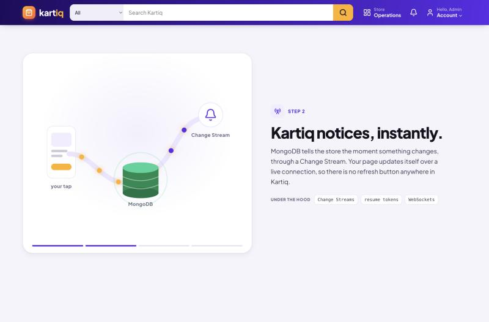

# Real-Time Retail Intelligence Platform — Project Report

**Course:** 21CSE562T SQL and NoSQL for Data Science · **Assessment:** CLA-2, MongoDB Application Development
**Stack:** MongoDB 7 (replica set) · FastAPI (Python) · React 18 · pandas / scikit-learn

---

## 1. Introduction

**Problem.** Online stores collect large amounts of order and browsing data, but it often sits unused, or is analysed in weekly reports long after a customer has moved on. A store benefits from knowing, *while the customer is shopping*:
- what kind of customer they are;
- what they are likely to want next;
- whether their behaviour looks unusual.

**What we built.** **Kartiq**, a full-stack online store on the real Olist Brazilian e-commerce dataset, where MongoDB is the centre of the application:
- **Shopping:** shoppers sign up, search, read reviews, buy (with simulated payment) and track orders live.
- **Analytics:** three aggregation pipelines turn the raw data into features.
- **Models:** three lightweight models (K-Means, collaborative filtering, Isolation Forest) learn only from those aggregation outputs and write their results back into MongoDB.
- **Live updates:** Change Streams push every relevant change to the browser.

**What is new here.** Segmentation, recommendation and anomaly detection usually live in separate tools. Here they run in one MongoDB system, every model learns from aggregations MongoDB computes itself, and the results act on the shopper in real time:
- the shopper's **segment** sets their offer;
- **recommendations** shape the home page;
- a **HIGH risk** score holds an order for review.

## 2. Architecture

```
React (Vite) ──REST /api──► FastAPI ──pymongo──► MongoDB replica set (rs0)
     ▲                         │                       │
     └──── WebSocket /ws ◄─────┴──── Change Stream ◄───┘
                               │   (events, orders, notifications, alerts)
                               ├─ transactions: sign-up, checkout, cancel, review
                               ├─ scoped re-runs + saved models (live segment, risk)
                               └─ workers: Change Stream, fulfilment, live traffic
Offline / admin: Pipelines A, B, C ──► Modules 1, 2, 3  (ml/run_all.py, ~20 s)
```

- **Front end.** React with React Router. Pages: Home (with the 3-D taste map), Today's deals, Search, Product, Cart, Checkout, Orders and Order detail (live tracker), Account, Login/Sign-up, How Kartiq works (a scroll story), and the admin area (Operations, Customer 360). It is deliberately not a dashboard: the main users are shoppers, and the admin area is a set of work queues (approve or reject held orders, resolve alerts) with analytics as a secondary panel.
- **Back end.** FastAPI with routers for auth, catalog, shopping, admin and system, and a service layer (catalog, cart, checkout, personalization, intelligence, realtime, fulfillment).
- **Auth.** Passwords are stored as salted scrypt hashes, and logins return a signed JWT. Every admin route checks the role.

**The running app: Kartiq.** The store is branded **Kartiq** ("cart" + "IQ"; tagline *Smart shopping, live*). It has a violet-and-amber identity, line icons for every category, a marketplace-style price block in rupees, and motion that explains what is happening (section 2.1). Screenshots from the built app, served by FastAPI on port 8100:













### 2.1 Motion with a purpose

The store moves, but each animation shows something real rather than decorating the page:
- **The taste map (home page).** A globe of the store's 73 aisles, drawn on a `<canvas>` with no 3-D library. Dots are categories, sized by how many real customers bought in them. Lines are Module 2's category similarities, the same table "Recommended for you" reads (`GET /api/taste-graph`). The aisles are laid out by a small force simulation on a sphere (springs along similarity lines, repulsion between all aisles), so related aisles sit together. Every few seconds a pulse starts from the shopper's own aisles (their purchases, else their browsing, else the best-sellers), turns the globe to face it, and ripples out to the most similar aisles, which is how the store picks recommendations. The aisles the model recommends carry an amber ring. Shoppers can drag the globe, hover for counts, and tap an aisle to explore it.
- **How Kartiq works (`/how-it-works`).** A scroll story: the picture stays pinned while four steps scroll past (a tap becomes events; MongoDB's Change Stream notices; pipelines and models learn; the store updates live). Each step lists what runs "under the hood".
- **Shopping feedback.** Adding to cart flies a "+1" into the cart icon, which bounces when it lands. The free-delivery bar fills with a truck riding on it. The order tracker's line grows as each status arrives over the WebSocket, and a placed order gets a confetti burst.
- **Restraint.** One easing curve throughout, nothing loops on the shopping pages except the live indicators, and everything turns off for people whose system asks for reduced motion.

## 3. Schema design (summary)

Full document structures, reasons and indexes are in `schema/schema_design.md`.

| Decision | Choice | Reason |
|---|---|---|
| Customer identity | one document per real person (`customer_unique_id`) | Olist issues a new `customer_id` per order; per-person keys give RFM a real Frequency |
| Order lines and payment | embedded in `orders` | bounded, immutable, read together; Pipeline B can `$unwind` instead of `$lookup` |
| Segment and risk results | embedded in `customers` | small, single writer, read on every offer, checkout and admin view |
| Events | separate flat collection | unbounded and write-heavy; the shape `$setWindowFields` partitions |
| Reviews | separate, referenced by product | unbounded, paged |
| Cart | one document per customer, `_id` = customer id | small, read and written whole |
| Credentials | `users` referenced to `customers` | keeps secrets out of the analytics document |
| Product read model | price, rating and sales counts pre-aggregated on `products` | read-heavy search pages need no joins; kept correct with `$inc` in transactions |
| Indexes | many on read-heavy collections, two on `events` | every index slows every insert |

## 4. RDBMS vs NoSQL trade-off

This comparison is about this project's workload, not a claim that one model always wins.

1. **Variable event structure.** `events.metadata` differs by event type and source: a search carries a query, a declined payment a reason, an app purchase an order id. A relational design needs either a wide table of mostly-NULL columns or an entity-attribute-value table with an extra join per query. Every new event type also means an `ALTER TABLE` and a backfill. In MongoDB a new event type is just a new document.
2. **Two opposite workloads in one database.** `events` is write-heavy and carries two indexes. `products`, `orders` and `customers` are read-heavy and carry the indexes their pages need. Each collection is tuned on its own.
3. **Reads that match the screen.** An order page is one document with its lines and payment; a search page is one `$facet` aggregation returning results plus every filter count. The relational version is several joins, or several queries.
4. **Event-driven reactivity built in.** Change Streams tail the oplog: nothing is queried while nothing changes, and updates arrive within a second when something does. The relational version needs polling (`WHERE updated_at > last_seen`) or triggers plus an external queue.
5. **Where an RDBMS would still win.** Highly normalised, ledger-style data with many cross-entity constraints. MongoDB now has multi-document ACID transactions (used here for checkout), but a relational database enforces foreign keys and constraints declaratively, whereas here the application must do it.

## 5. Data provenance statement

Four kinds of data exist, and each is labelled so they can never be mixed up:

- **REAL:** the Olist Brazilian E-Commerce dataset, 2016–2018: 96,096 customers (real people), 99,441 orders, 32,951 products, 102,230 product reviews and the sellers. It is loaded by `data/load_olist_data.py` with `source: "olist"`. No field is invented.
  - Product display names (e.g. "Bed Bath Table #99A478") are derived from the category and product id, because the dataset has no names or photos.
  - Price, rating, sales count and seller location are computed from the real files.
- **SYNTHETIC:** browsing, cart, purchase and abandon events from `simulator/event_simulator.py`, labelled `metadata.is_synthetic: true` and `metadata.source: "simulator"`. Documented assumptions:
  - about 70% cart abandonment (Baymard Institute benchmark range, 65–75%);
  - log-normal session length;
  - exponential gaps between clicks (mean 25 s);
  - 60% of product views come from categories the customer really bought;
  - about 3% of simulated customers follow an "intense" persona (about 2 s between clicks, frequent abandonment). That persona is ground truth for evaluating Module 3 only and is never a model feature.

  These events are always presented as simulated behaviour, never as real user activity.
- **APP:** accounts, carts, orders, reviews and events created by people using the store (`source: "app"` / `metadata.source: "app"`). Payments and order fulfilment are simulated, and the UI says so.
- **TEST FIXTURE:** `data/generate_sample_seed.py` (`source: "fixture"`). It is only ever written to the throw-away `retail_intel_test` database, and is not used in any reported result.

## 6. Aggregation pipelines

**Pipeline A — RFM** (`pipelines/pipeline_a_rfm.py`):
1. `$match` keeps completed orders (delivered or shipped).
2. `$group` by customer computes `$min`/`$max` purchase date, `$sum` order count (Frequency) and `$sum` payment value (Monetary) in one pass.
3. `$addFields` computes Recency in days. The reference date is the end of the Olist data (2018-10-18) for historical customers, and "now" when the last order was placed in the app; measuring 2018 orders from today would make everyone look eight years inactive.
4. `$lookup` + `$unwind` attach the profile.
5. `$merge` writes `rfm_features`.

The same pipeline runs scoped to one customer (`$match` on `customer_id` first) right after their order ships.
*Syllabus: T10 aggregation and T13 aggregation pipeline design (several accumulators in one `$group`, a `$lookup` join).*

**Pipeline B — category affinity** (`pipelines/pipeline_b_affinity.py`):
1. `$match` keeps completed orders.
2. `$unwind` flattens the embedded `line_items`, which is the payoff of embedding them.
3. `$group` by (customer, category) computes spend, units and `$addToSet` order ids; `$size` turns those into a count.
4. `$merge` writes `category_affinity`, the customer × category matrix for Module 2.

*Syllabus: T13, array flattening before grouping.*

**Pipeline C — rolling behavioural metrics with `$setWindowFields`** (`pipelines/pipeline_c_rolling_metrics.py`). After a `$sort`, the first **`$setWindowFields`** stage uses `partitionBy: "$customer_id"` and `sortBy: {timestamp: 1}`, and computes four outputs per event:

| Output | Window | Meaning |
|---|---|---|
| `rolling_event_count_7d` | RANGE `[-7, 0]` days | events in the trailing 7 days of that event's own timestamp |
| `prev_timestamp` | `$shift` by -1 | the previous event in the same partition |
| `cart_to_purchase_trend` | DOCUMENTS `[-9, 0]` | share of the last 10 events that were purchases |
| `cart_abandon_trend` | DOCUMENTS `[-9, 0]` | share of the last 10 events that were abandoned carts |

Then `$addFields` derives `session_gap_seconds` from the shifted timestamp. A **second `$setWindowFields`** stage (needed, because it uses a field the first stage creates) computes `avg_session_gap_seconds` as `$avg` over DOCUMENTS `[-9, 0]`. `$merge` writes `rolling_behavioral_metrics`. The Change Stream worker runs the same pipeline scoped to one customer.
*Syllabus: Unit 3 window-style functions, implemented specifically as MongoDB's `$setWindowFields` (the equivalent of SQL `OVER (PARTITION BY … ORDER BY … RANGE/ROWS …)`).*

**Pipelines inside the app:**
- **Delivery promise (`data/enrich_products.py`):** `$match` delivered orders → `$project` days from purchase to delivery → `$unwind` line items → `$group` by product with MongoDB 7's **`$median`** accumulator → `$merge` into `products` (`on: "product_id"`). The store promises "FREE delivery **Mon, 16 Nov**" as today plus that real median.
- **Today's deals:** `$addFields` computes each product's gap below the highest price it really sold for (`$divide`/`$subtract` on `price_range.max`) → `$match` gaps of 15–60% → `$sort` by gap.
- **Search:** `$match` with `$text` (a weighted text index) → `$addFields` text score → **`$facet`**, which returns the page of results, the total (`$count`), category counts (`$group`), price ranges (`$bucket`) and rating buckets (`$bucket`) in one round trip.
- **"Customers who bought this also bought":** `distinct` buyers of the product → orders of those buyers → `$unwind` → `$group` by product with `$addToSet` buyers → `$size` → `$sort` → `$lookup` products.
- **Admin overview:** `$group` segment and risk distributions, and 24-hour revenue in rupees (`$ifNull` on the order's charged amount).
- **Price filters in rupees:** the search `$facet` buckets products with `$bucket` on `{$round: [{$multiply: ["$price", rate]}, 0]}`, the rupee price itself, while the price filter is converted to a reais range so the query still uses the `price` index.

### Pricing that stays honest

The price block looks like a big marketplace's, but every number on it comes from the data:
- **Rupees.** The catalogue is priced in Brazilian reais, the currency of the real data. Kartiq shows and charges Indian rupees, converted at one fixed rate (₹17.80 per R$1, the late-October 2026 mid-market rate) and rounded to the whole rupee, the way Indian stores price. Totals, discounts and delivery are then worked out in rupees, so the numbers on screen always add up; paise appear only where a percentage creates them (₹1,326.60). The rule is "reais in the database, rupees on the wire": `backend/app/services/money.py` converts at the API boundary, and the analytics keep working in reais.
- **M.R.P.** is the highest price the product really sold for in Olist (`price_range.max`). It and the "% off" are shown only when today's price is 5–60% below it. Smaller gaps are noise; larger ones are one-off outlier sales, which would look like fake discounts.
- **Delivery dates** come from the `$median` of real delivery times for that product, capped at 30 days.
- **Free delivery** is a store rule: orders of ₹2,500 or more ship free, and **Kartiq Plus** members (the High-Value Loyal segment from K-Means) always get free delivery. The cart shows a free-delivery progress bar and the total saved against M.R.P.
- **Orders keep both currencies.** An app order stores what the shopper paid in rupees (a `charged` block, with the rate used) and the same amounts in reais in the Olist-shaped fields (`unit_price`, `items_total`, `total`, `payment.total_value`). Pipelines A and B therefore read app orders exactly like Olist orders, and live re-segmentation is not thrown off by a different currency.

## 7. Transactions (Unit 5)

Four operations are multi-document ACID transactions (`session.with_transaction`). If any step fails, none of it happens.

- **Checkout:**
  1. Re-read the cart inside the transaction and refuse if it changed.
  2. Insert the order.
  3. Empty the cart.
  4. `$inc` the sales count of each product.
  5. Insert the purchase events.
  6. Update the customer's counters.
  7. Insert the "order placed" notification.

  A declined (simulated) payment never opens the transaction: no order is created, the cart stays, and a `payment_failed` event is recorded.
- **Cancel / reject:** a conditional status update (only if still cancellable) plus restoring the product counters.
- **Sign-up:** the customer profile and the login account are created together.
- **Review:** insert the review and update the product's running average and count (an update pipeline).

Single-document updates are already atomic in MongoDB and need no transaction. Examples: the cart quantity cap is an update pipeline with `$map`, and admin approval is a conditional `update_one` on `order_status: "under_review"`.

## 8. Real-time layer (Change Streams)

One background thread opens a single Change Stream on the database, filtered to `events`, `orders`, `notifications` and `alerts`, with `fullDocument: "updateLookup"` and a resume token:

| Change | Reaction |
|---|---|
| event inserted | pushed to the admin live feed; per-customer sliding windows count `cart_abandon` (3 in 30 min) and `payment_failed` (2 in 10 min). Crossing a threshold re-runs Pipeline C for that customer, scores them with the saved Isolation Forest, writes `customers.anomaly`, and inserts an alert if HIGH |
| order status updated | pushed to that customer's open tabs (the tracker moves by itself), and a notification is stored; on "shipped", the customer is re-segmented (Pipelines A and B scoped, then K-Means with the saved model) and told if a new perk unlocked |
| notification inserted | pushed to the user's bell instantly |
| alert inserted | pushed to the admin's alert list instantly |

Order fulfilment is simulated by a worker that moves app orders processing → shipped → delivered every 20 s, as ordinary updates the Change Stream then sees. The admin can also start live **synthetic** traffic, which runs the simulator in real time.

## 9. Machine-learning modules

The executed notebook `notebooks/ml_analysis.ipynb` contains the plots and tables for this section.

**Module 1 — customer segments (K-Means on `rfm_features`).**
- **Preprocessing:** Frequency and Monetary are `log1p`-transformed (heavily skewed), then all three features are standardised.
- **Choosing k:** silhouette on a 10,000-customer sample over k = 4–6; at least 4 actionable segments are a business requirement. Silhouette: k=4 **0.369**, k=5 0.350, k=6 0.342. The elbow plot agrees.
- **Naming:** deterministic rules on the centroids (highest frequency → High-Value Loyal; of the rest, oldest → At-Risk, lowest spend → Bargain Browser, highest spend → Big Spender).
- **Result over 94,399 customers:**

  | Segment | Customers | Mean frequency | Mean spend | Days since last order |
  |---|---|---|---|---|
  | Bargain Browser | 36,314 | 1.0 | R$70 | 197 |
  | Big Spender | 27,972 | 1.0 | R$320 | 224 |
  | At-Risk | 27,252 | 1.0 | R$119 | 475 |
  | High-Value Loyal | 2,861 | 2.1 | R$307 | 271 |

- Spend in this table is in reais, the currency of the data; the store only converts to rupees for display (R$70 ≈ ₹1,246).
- **Live use:** each segment has its own offer. The model is saved, so one customer can be placed in a segment live.
- **Why K-Means:** 3 roughly convex features, a fit takes about a second on about 94k customers, and the centroids are interpretable. A Gaussian mixture or deep clustering adds tuning cost and loses interpretability without a clear gain here.

**Module 2 — recommendations (item-based collaborative filtering on `category_affinity`).**
- **Method:** a customer × category matrix of `log1p(spend)`, then cosine similarity between category columns (74 × 74), saved to `category_similarity`.
- **Evaluation:** a leave-one-category-out protocol on customers with 2+ categories, split by customer into test (458), validation (458) and train. A CF + popularity blend weight α was chosen on validation (**α = 1.0**).

  | Ranker (held-out test) | HitRate@3 | HitRate@5 |
  |---|---|---|
  | **CF + popularity (used by the store)** | **0.345** | **0.472** |
  | Popularity only (baseline) | 0.290 | 0.456 |
  | CF only | 0.245 | 0.362 |

- **Interpretation:** about 97% of customers buy once, so co-purchase data is thin. The blend beats both. Every recommendation stays explainable ("because you shop in X").
- **Cold start:** new users get recommendations from their browsing.
- **Why not matrix factorization:** the category matrix is small and dense; MF pays off on large, sparse product-level matrices (future work).

**Module 3 — behavioural risk (Isolation Forest on `rolling_behavioral_metrics`).**
- **Features:** the latest `$setWindowFields` row per customer (count over 7 days, average gap over the last 10 events, purchase share, abandon share). Count and gap are `log1p`-scaled; a missing gap is filled with the median.
- **Model:** 200 trees, `contamination = 0.1`. Labels come from score percentiles: the bottom 10% are HIGH and the next 20% MEDIUM.
- **Result:** 1,464 simulated customers scored (1,025 LOW, 293 MEDIUM, 146 HIGH).
- **Evaluation against the simulator's known "intense" persona:**
  - recall at HIGH: **17/19 = 89%**;
  - recall at HIGH or MEDIUM: 95%;
  - precision at HIGH: 0.12. This is capped by design, since HIGH is always 10% of customers.
- **Live use:** the saved model scores a single customer within a second of a Change Stream trigger, and a HIGH score holds that customer's next order for review.
- **Why Isolation Forest:** no labels, few features, millisecond training, and a naturally bucketable score. An autoencoder needs more data and gives a less interpretable reconstruction error.

## 10. API overview

| Area | Endpoints |
|---|---|
| Auth | `POST /api/auth/signup` · `POST /api/auth/login` · `GET /api/auth/me` |
| Catalog | `GET /api/store` (currency, rate, free-delivery rule) · `GET /api/categories` · `GET /api/deals` · `GET /api/products` (q, category, price in ₹, rating, sort, page) · `GET /api/products/{id}` · `GET/POST /api/products/{id}/reviews` |
| Shopping | `GET /api/home` · `GET /api/taste-graph` · `GET /api/recommendations` · `GET/POST/PATCH/DELETE /api/cart…` · `POST /api/events` · `GET /api/checkout/preview` · `POST /api/checkout` · `GET /api/orders` · `GET /api/orders/{id}` · `POST /api/orders/{id}/cancel` · `GET /api/notifications` · `POST /api/notifications/read` |
| Admin | `GET /api/admin/overview` · `GET /api/admin/orders` · `POST …/orders/{id}/approve or reject` · `GET /api/admin/alerts` · `POST …/alerts/{id}/resolve` · `GET /api/admin/customers` · `GET /api/admin/customers/{id}` · `POST /api/admin/analytics/run` · `GET /api/admin/analytics/runs` · `GET/POST /api/admin/simulator` |
| System | `GET /api/health` · `WS /ws?token=…` · interactive docs at `/docs` |

## 11. Testing and verification

- **Automated (27 tests, about 9 s, `pytest`).** They run against a separate `retail_intel_test` database on the real replica set, so transactions and `$setWindowFields` actually execute.
  - Pipeline A's frequency equals the completed-order count, and the scoped re-run works.
  - Pipeline B's spend equals the line-item sum.
  - Every Pipeline C window output matches a hand computation (RANGE count, `$shift` gap, DOCUMENTS shares, average gap).
  - The K-Means model is saved and assigns segments; recommendations exclude bought categories; the evaluation compares three rankers; Isolation Forest finds the intense fixtures, and live scoring matches the batch label.
  - Sign-up, login and roles work, including duplicate email and a wrong password.
  - Search, facets and the substring fallback work; price filters and price buckets are in rupees.
  - The checkout transaction commits everything; a declined payment creates nothing; card and coupon validation work; cancel restores counters; card numbers are never stored.
  - The held-order flow works with admin approval.
  - Pricing rules hold: prices convert to whole rupees and format as ₹1,23,456.78; M.R.P. comes from the real highest price (outliers ignored); delivery is free over ₹2,500 or for Plus members; deals show only real discounts; a placed order stores the rupees charged and the same amounts in reais.
  - The taste-map endpoint links only real categories, with similarity weights scaled to at most 1.
  - The Change Stream handler pushes order statuses and notifications; three abandons trigger exactly one risk re-score; the fulfilment step works; WebSocket authentication works.
- **Manual run in a browser:**
  1. Sign up, search, add to cart, and pay with the test card; the order tracker moves to Shipped by itself.
  2. Abandon the cart three times; a live HIGH alert appears for the admin, and the next order is held.
  3. Approve it from the admin queue.
  4. Check the Customer 360 page.
  5. Watch the taste map pulse from the shopper's own aisles, drag it, and tap an aisle; scroll through How Kartiq works.
  6. Check the phone layout (no horizontal scrolling; filters collapse; the story's picture stays pinned).

## 12. Limitations and future work

- **Synthetic behaviour.** Simulator parameters come from published benchmarks and stated assumptions, not fitted to a real clickstream. A production system would calibrate them on real session logs. The Isolation Forest cut-offs (10% / 30%) are assumptions, since no real fraud labels exist.
- **Historical catalog.** Orders are from 2016–2018, product names are derived, and there are no images.
- **Category-level recommendations.** Product-level matrix factorization, or embeddings, need denser data.
- **Single process.** The Change Stream thresholds are kept in memory (lost on restart), and WebSockets live in one API process. Production would persist that state (or use a queue such as Redis) and run several API instances behind a pub/sub layer.
- **Scale.** Shard `events` on `customer_id`, which matches the existing compound index. Roll raw events up and expire them with a TTL index once summarised.
- **One fixed exchange rate.** Rupee prices use a single documented rate; a real cross-border store would refresh it on a schedule and record the rate on every order (the order already stores the rate it used).
- **Payments and fulfilment are simulated.** A real store would use a payment gateway's tokenisation, so card data never reaches the server, and a carrier's tracking webhooks.

## 13. Conclusion

MongoDB turned real online-store orders and simulated shopping activity into live insights for each customer: what type of customer they are, what they might buy next, and whether their behaviour looks unusual. Its flexible documents, aggregation pipelines (including `$setWindowFields`), multi-document transactions and Change Streams made this simpler and closer to real time than a traditional relational design would, while real, synthetic and app-generated data stayed clearly separated.
